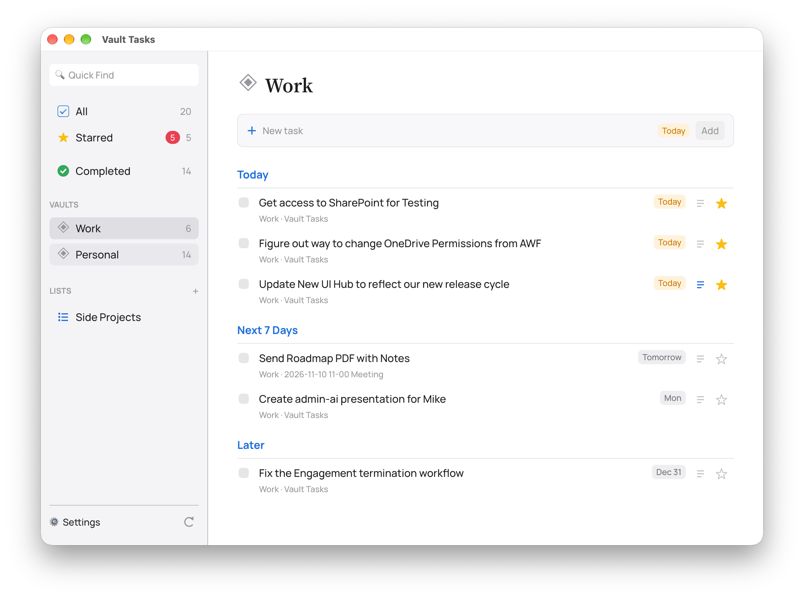

# Vault Tasks
A small native macOS app that gathers every open task from your Obsidian vaults into one list. It's for people who keep tasks in Obsidian using the [Tasks plugin](https://github.com/obsidian-tasks-group/obsidian-tasks) format (`- [ ] Call Bob 📅 2026-11-15`). It reads and writes that same format, so your tasks stay in your notes and keep working in Obsidian.

> **No prebuilt downloads.** The app isn't signed or notarized with an Apple Developer account, so there's no download to install. You build it from source on your own Mac, which takes a few minutes. The steps are below.

<!-- Screenshot: add one at docs/screenshot.png and remove this comment -->


## Features

### Your tasks in one place
- **All** groups open tasks by due date: Overdue, Today, Next 7 Days, Later and No Due Date.
- **Starred** shows tasks you star. Starring sets the task's ⏳ scheduled date to today, so it also shows as scheduled in Obsidian.
- **Completed** lists tasks done today, in the past 7 days or the past 30 days. Uncheck one to reopen it.
- A view for each vault, plus Quick Find, which also searches notes.
- Optionally group by file instead of by date.

### Working with tasks
- Check a task off to mark it done in its note (`[x]` and `✅ date`), with an optional chime and an Undo bar.
- Click a task's name to rename it. Dates, priority, recurrence and tags stay on the line. Long names wrap.
- Click the grey vault and file line under a task to open its note in Obsidian. With the free [Advanced URI](https://github.com/Vinzent03/obsidian-advanced-uri) plugin enabled, the note opens at the task's line.
- Click a date chip to set, change or remove a due date, with quick picks and a calendar (weeks start on Sunday).
- Recurring tasks (`🔁 every week`) open in Obsidian when checked, so the Tasks plugin can create the next one.

### Adding tasks
- Type in the new task box and press Enter. Tasks go to `Vault Tasks.md` at the root of the chosen vault.
- **Natural language dates:** a phrase at the start or end of the task sets the due date and is left out of the name. "Send report fri" becomes "Send report" due Friday. It understands today, tomorrow, weekday names, next week, next monday, in 3 days, in 2 weeks, nov 15 and 11/15. A date picked in the calendar wins.
- **Quick capture:** press Ctrl+Option+Space anywhere on your Mac to open a small window, type a task and press Enter. It's added to `Vault Tasks.md`, the same note as tasks added in the app, in the vault you pick in Settings. The note and shortcut can be changed. It works even when the app is hidden or minimized.

### Notes and lists
- **Notes:** click the ≡ button on a task to add notes. Markdown works: bullets, checkboxes, **bold**, *italic*, `code`, headings and links.
- **Lists:** make your own lists under LISTS in the sidebar. Add tasks by dragging them onto a list, from a task's notes panel, by right-clicking a task, or with Move to list. Right-click a list to rename or delete it.
- Notes and lists are saved in `.vault-tasks.json` at each vault's root, so they sync with your vault and don't clutter your notes. The first time a task gets notes or a list, the app adds an Obsidian block ID (`^vt-abc123`) to the end of its line so it can find the task again after edits.

### Editing many tasks at once
- Cmd-click to add or remove a task from the selection, Shift-click to select a range, Cmd-A to select everything shown, Esc to clear.
- While tasks are selected, an action bar offers Today, Tomorrow, Next week, a date picker, Move to list and Complete.
- "Reschedule all to today" on the Overdue heading.
- If a note can't be written, the others still update and the app tells you which tasks didn't.

### Look and feel
- Light and dark themes, or match macOS.
- Choice of font and text size, a native menu bar and keyboard shortcuts.

## Requirements
- A Mac running macOS 11 or later (Apple Silicon or Intel).
- The Rust toolchain, installed with rustup (steps below).
- Obsidian, with tasks written in the Tasks plugin format. The Tasks plugin itself is recommended so recurring tasks work, but the app reads and writes the format without it.

## Build and Run
These steps assume you haven't used Rust before. Run each command in the Terminal app.
1. Install the Xcode command line tools, which Rust needs to build Mac apps. Skip this if you already have them.
```bash
xcode-select --install
```
2. Install Rust with rustup. Accept the default options when it asks, then close and reopen Terminal.
```bash
curl --proto '=https' --tlsv1.2 -sSf https://sh.rustup.rs | sh
```
3. Download the source code. Replace the address with this repository's URL.
```bash
git clone https://github.com/OWNER/vault-tasks.git
```
```bash
cd vault-tasks
```
4. Build it. The first build downloads libraries and takes a few minutes.
```bash
cargo build --release
```
5. Run it.
```bash
./target/release/vault-tasks
```

### Put It in Applications
To get a proper app with an icon that you can open from Launchpad or Spotlight, build the app bundle and install it into `~/Applications`:
```bash
./bundle.sh --install
```
Run the same command again after pulling new changes to update it. Other options: `--universal` builds one app for both Apple Silicon and Intel, and `--zip` also writes a zip of the app to `target/`.

Because you built the app on your own Mac, macOS opens it without the "unidentified developer" warning.

## First-Time Setup
1. Open the app. It looks for vaults in Obsidian's iCloud folder (`~/Library/Mobile Documents/iCloud~md~obsidian/Documents`).
2. If your vaults are somewhere else, or none were found, open **Settings** (⌘,) and click **Add vault folder…** for each vault.
3. Optional: under **Excluded folders**, add folders to skip, such as templates or recipes.
4. Under **Quick capture**, pick the vault and note that captured tasks go to. The default is `Vault Tasks.md` in your first vault, the same note tasks added in the app go to. It's created the first time you add a task. You can also change the shortcut there, written like `ctrl+option+space` or `cmd+shift+k`. macOS doesn't need any extra permission for it. If another app already uses the shortcut, Settings says so.
5. Optional: Settings shows whether the Tasks and Advanced URI plugins are installed in each vault.

Settings are saved to `~/Library/Application Support/vault-tasks/config.json`.

## Task Format
Tasks are Markdown checkboxes anywhere in a vault's `.md` files:
```markdown
- [ ] Renew passport #personal 📅 2026-11-15 ⏫
```
These Tasks plugin markers are understood:
- `📅 2026-11-15` due date
- `⏳ 2026-11-15` scheduled date (used for Starred)
- `🛫 2026-11-15` start date
- `➕ 2026-11-15` created date
- `✅ 2026-11-15` done date
- `🔺 ⏫ 🔼 🔽 ⏬` priority
- `🔁 every week` recurrence
- `^block-id` an Obsidian block ID, which the app uses to attach notes and lists

`[ ]` is open, `[/]` is in progress and `[x]` is done. Other statuses, tasks in code blocks and hidden folders such as `.obsidian` are skipped.

When the app changes a task it only edits that task's line and keeps everything else on it. It re-reads the note right before writing, and if the line changed since the last scan it stops and asks you to refresh, so it won't overwrite an edit you made in Obsidian.

## Keyboard Shortcuts
- ⌘N new task, ⌘R refresh, ⌘, Settings
- ⌘1 All, ⌘2 Starred, ⌘3 Completed
- ⌘= bigger text, ⌘- smaller text, ⌘0 normal text
- Up and Down move between tasks
- Space completes, and T, M and W set today, tomorrow and next week, for the highlighted task or all selected tasks
- Cmd-A selects all tasks shown, Esc clears the selection
- Ctrl+Option+Space quick capture, from any app

## Custom Chime Sounds
The chime picker lists the macOS system sounds plus anything in `~/Library/Sounds`. Drop `.aiff`, `.wav`, `.mp3`, `.m4a` or `.caf` files there (Settings has an **Open folder** button). Short clips under one second work best. To convert a recording:
```bash
afconvert -f AIFF -d BEI16 input.m4a ~/Library/Sounds/MyDing.aiff
```

## Development
```bash
cargo run
```
```bash
cargo test
```
```bash
cargo clippy
```
- `src/main.rs` the app window, views, selection and settings
- `src/tasks.rs` scans vaults, parses tasks and edits task lines
- `src/natural_date.rs` turns phrases like "next friday" into dates
- `src/meta.rs` notes and lists stored in `.vault-tasks.json`
- `src/capture.rs` the system-wide quick-capture shortcut
- `src/menu.rs` the macOS menu bar
- `src/theme.rs` light and dark colors
- `src/fonts.rs` bundled fonts
- `assets/` icons and fonts. After editing an icon SVG, run `cargo run --example make_icon` to regenerate the PNGs and `assets/AppIcon.icns`.

GitHub Actions builds, lints and tests every push.

## About
Vault Tasks was built with [Claude Code](https://claude.com/claude-code). It's a personal project that I maintain in my spare time, so issues and pull requests are welcome, but replies may be slow.

Built with [egui](https://github.com/emilk/egui). The bundled fonts, Manrope and Source Serif 4, are under the SIL Open Font License (see `assets/fonts/README.md`).

## License
MIT. See [LICENSE](LICENSE).
